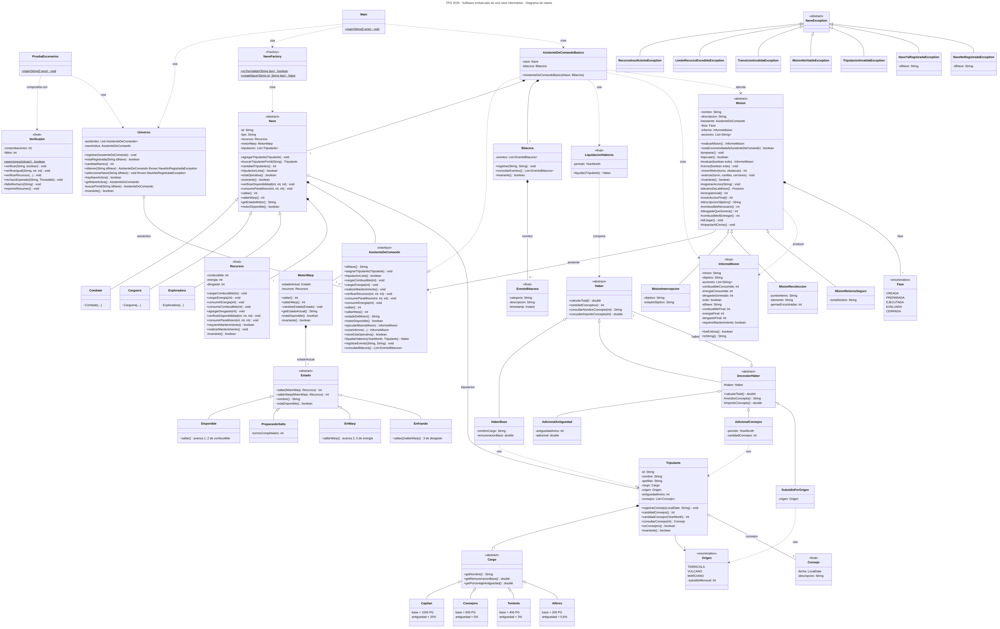

# TPG_Programacion

Software embarcado de una nave interestelar tripulada — TPG 2026, Programación C.

Entrega vigente: **Entrega 2** (etiqueta `entrega-e2`). La Entrega 1 quedó identificada con la etiqueta `entrega-e1`.

## Requisitos

- JDK 17 o superior
- Maven 3.8 o superior (opcional: ver *Sin Maven* más abajo)

## Configuración local

- **Base de datos:** se usa H2 embebida (dependencia `com.h2database:h2` del `pom.xml`, la baja Maven).
  No hay que instalar nada: al iniciar, el sistema crea la base en `./datos/tpg.mv.db` (relativo a la carpeta
  desde donde se ejecuta) y ejecuta `database/schema.sql`, que usa `IF NOT EXISTS` y no borra datos.
  Usuario `sa`, sin contraseña. La carpeta `datos/` está en el `.gitignore`.
- Solo se persisten las credenciales de los usuarios (nombre y hash de la contraseña con su sal).
  Naves, tripulantes y misiones no se guardan (Enunciado Parte 2).
- Para empezar de cero, borrar la carpeta `datos/`.

## Compilación

```
mvn clean compile
```

## Iniciar el sistema (interfaz gráfica)

```
mvn compile exec:exec
```

`exec:exec` lanza una JVM aparte con `-ea`, porque las precondiciones del modelo se comprueban con `assert`.
Por defecto arranca `ar.edu.unmdp.tpg.app.MainGrafico`.

### Sin Maven

En la raíz hay tres scripts que compilan con `javac` y ejecutan con `-ea`; alcanza con tener el JDK:

- `ejecutar_ventanas.bat`: abre la interfaz gráfica.
- `ejecutar_demo.bat`: lo mismo, pero arranca con la nave de combate `COM-1` ya creada y con su tripulación
  completa, para ir directo a las misiones (es `ejecutar_ventanas.bat demo`).
- `ejecutar_pruebas.bat`: corre `PruebaEscenarios`; se le puede pasar otra clase, por ejemplo
  `ejecutar_pruebas.bat ar.edu.unmdp.tpg.visor.PruebaVisor`.

Sin Maven el jar de H2 no se baja solo: hay que dejarlo en la carpeta `lib/` (ver `lib/LEEME.txt`). Si no está,
el programa avisa y guarda los usuarios en memoria durante esa ejecución.

Para registrar de una vez los usuarios del grupo en la base: `ejecutar_pruebas.bat ar.edu.unmdp.tpg.test.CrearUsuariosDemo`.

Recorrido sugerido:

1. **Acceso:** en la ficha *Registrarse* dar de alta un usuario (3 a 30 caracteres, contraseña de 4 o más) y
   después ingresar en *Iniciar sesión*. En una ejecución posterior el usuario sigue existiendo.
2. **Creación:** escribir un id, elegir el tipo de nave y *Crear nave*. Asignarle un **capitán y cuatro
   tripulantes más** (sin eso la nave no puede iniciar misiones).
3. **Tripulantes:** tabla con la tripulación y el salario del mes de cada uno, y el detalle concepto por
   concepto. Se puede registrar un consejo del consejero seleccionado.
4. **Control de la Nave:** iniciar M-01, M-02 o M-03 y ver el avance en el tablero, los recursos, la
   bitácora y el historial de informes, que se actualizan solos. Con la nave quieta **y en la base de
   origen** se puede cargar combustible o energía y hacer mantenimiento; si quedó lejos después de una
   misión, primero tiene que volver con M-03.
5. **Visor Recóndito:** agregar naves consumidoras y generadoras de energía y ver los eventos de la
   plataforma de carga en vivo.

Referencias del tablero: `NAV` nave, `OBJ` objetivo de la misión, `BAS` base de origen (centro),
`Ast` asteroide, `Est` estación de carga, `Exp`/`Car`/`Com` naves enemigas, `Res` restos de una nave destruida.

## Verificación

Verificación de escenarios con resultados esperados (sale con código 0 si todo coincide):

```
mvn compile exec:exec -Dprograma=ar.edu.unmdp.tpg.test.PruebaEscenarios
```

Otras verificaciones:

| Programa | Qué verifica |
|---|---|
| `ar.edu.unmdp.tpg.test.PruebaEscenarios` | Escenarios A, B, C y D de la ficha con los costos y el Motor Warp del Anexo, contratos (E), navegación por un tablero con asteroides y haberes. |
| `ar.edu.unmdp.tpg.test.PruebaElementos` | Asteroides, estaciones de carga y la tabla de batallas (Double Dispatch). |
| `ar.edu.unmdp.tpg.test.PruebaAcceso` | Registro e inicio de sesión con DAO/DTO y JDBC sobre H2. Ejecutarlo dos veces comprueba que el usuario persiste. |
| `ar.edu.unmdp.tpg.test.PruebaTablero` | Integración del Tablero y Destino de la cátedra y su Observer. |
| `ar.edu.unmdp.tpg.visor.PruebaVisor` | Productor-Consumidor: la plataforma nunca supera su capacidad. |
| `ar.edu.unmdp.tpg.app.Main` | Demostración por consola de las tres misiones sobre un tablero con elementos. |
| `ar.edu.unmdp.tpg.test.CrearUsuariosDemo` | Registra en la base los usuarios del grupo (no es una prueba, es para la demo). |

Cada uno se ejecuta con `mvn compile exec:exec -Dprograma=<clase>`.

La salida de una corrida de `PruebaEscenarios` está en [`docs/ejecuciones.txt`](docs/ejecuciones.txt).
En [`docs/evidencias.md`](docs/evidencias.md) está, para cada requerimiento, dónde se verifica y qué se espera.

## Diagrama de clases



También en [`docs/uml-clases.svg`](docs/uml-clases.svg). El fuente, en Mermaid, es [`docs/uml-clases.mmd`](docs/uml-clases.mmd).

En [`docs/uml/`](docs/uml/) hay un diagrama por tema (concurrencia, tablero y batallas, acceso con DAO/DTO).

## Patrones de diseño

| Patrón | Dónde está | Cómo se aplica |
|---|---|---|
| **Factory** | `naves.NaveFactory`, `elementos.FabricaDeElementos`, `tripulacion.FabricaDeCargos` | El cliente pide un tipo y recibe el objeto armado sin conocer las clases concretas. Los constructores de `Combate`, `Carguera` y `Exploradora` son package private. |
| **State** | `motorwarp.MotorWarp` y sus estados | El motor expone solo `saltar()` y `saltarWarp()` y se las delega a su estado actual. Cada estado decide (salto simple, turno de preparación, salto warp, enfriamiento) y le setea al motor el estado siguiente. No hay `if` sobre el estado. |
| **Template Method** | `mision.Mision` | `realizarMision()` es `final` y fija preparar → ejecutar → evaluar → cerrar. Las misiones concretas solo redefinen los pasos que dependen de cada una (destino, energía de despegue, recursos a entregar, qué pasa al llegar y al cerrar). |
| **Decorator** | `haberes.Haber`, `haberes.DecoratorHaber` | `HaberBase` tiene el sueldo del cargo; cada adicional envuelve un haber y le suma su concepto. |
| **Double Dispatch** | `naves.Nave` y sus subtipos | `nave.enfrentar(enemiga)` llama a `enemiga.recibirDesafioDe(nave)`, que llama a `nave.contraXxx()`: el resultado depende de los dos tipos sin `instanceof`. |
| **Observer** | `destino.Observable` / `destino.Observador` (de la cátedra) | Los usan el `Tablero`, la `Bitacora`, el `ModeloAplicacion` y el `CanalDeEventos` del visor. Las vistas se registran en los modelos y se actualizan solas; los modelos no conocen a las vistas. |
| **MVC** | paquetes `vista`, `controlador`, `aplicacion` y `visor` | Cada vista implementa una interfaz con sus comandos; cada controlador implementa `ActionListener`, invoca al modelo y coordina la respuesta con la vista. |
| **DAO / DTO** | `persistencia.UsuarioDAO`, `UsuarioDAOJDBC`, `UsuarioDTO` | El servicio de acceso solo conoce la interfaz DAO. El DTO lleva los datos del usuario entre la base y el servicio. |
| **Productor-Consumidor con monitores** | `visor.modelo.PlataformaDeCarga` | Métodos `synchronized`, condiciones de guarda en `while` con `wait()` y `notifyAll()`. Cada generadora y cada nave consumidora es un `Thread`. |

## Navegación y Motor Warp

En cada turno de la misión (Enunciado Parte 2 y Anexo):

1. **Inspección:** si en la casilla de la nave hay un elemento, la nave interactúa con él (asteroide: −10 de
   energía; estación: recarga; otra nave: batalla por Double Dispatch).
2. **Escaneo:** el radar de corto alcance mira la próxima casilla de la ruta.
3. **Movimiento:** si hay un asteroide adelante, la nave intenta el **salto warp** (2 turnos de preparación,
   salto de 2 casilleros con 5 de energía y 1 turno de enfriamiento con 3 de desgaste). Si no, **salto
   simple** (1 casillero, 2 de combustible).
4. **Turno del tablero:** `Destino` mueve los elementos al azar.

Si el combustible o la energía llegan a 0, o el desgaste a 100, la nave se destruye y la misión falla.

Costos de cada misión (Anexo): despegue M-01 4/5/4, M-02 4/10/4, M-03 4/0/4 (combustible/energía/desgaste).
Al llegar: M-01 entrega a la nave aliada lo que pidió (entre 0 y 50 de energía y de combustible), M-02 recolecta
entre 20 y 100 gemas y M-03 recarga todo al 100 % y deja el desgaste en 0.

## Manejo de excepciones

Todas las fallas del dominio derivan de `NaveException` (checked):

| Excepción | Cuándo se lanza |
|---|---|
| `RecursoInsuficienteException` | La operación necesita más combustible o energía del disponible (por ejemplo, un salto sin combustible). |
| `LimiteRecursoExcedidoException` | La operación dejaría un recurso por encima de 100. |
| `MisionNoViableException` | La misión no puede iniciarse (motor ocupado, tripulación incompleta, sin recursos), ya fue realizada o ya hay otra en curso. |
| `TripulacionInvalidaException` | Tripulante repetido o consejo de alguien que no es consejero. |
| `NaveYaRegistradaException` / `NaveNoRegistradaException` | Alta repetida o búsqueda de una nave inexistente en el `Universo`. |

En el acceso: `UsuarioExistenteException` y `CredencialesInvalidasException` (reglas del servicio) y
`PersistenciaException` (fallas de la base, en el DAO).

## Contratos

Las clases públicas están documentadas con Javadoc (precondiciones, postcondiciones e invariantes). Las
precondiciones se comprueban con `assert`. Para generar la documentación:

```
mvn javadoc:javadoc
```

## Estructura de paquetes

Todo el código está bajo `src/main/java/ar/edu/unmdp/tpg/`:

| Paquete | Contenido |
|---|---|
| `app` | `MainGrafico` (interfaz gráfica) y `Main` (demostración por consola). |
| `aplicacion` | `ModeloAplicacion` (modelo de la aplicación del MVC) y `EjecucionDeMision` (hilo de la misión). |
| `vista` | Ventanas y paneles Swing, cada uno con su interfaz `IVista...`. |
| `controlador` | Controladores del MVC. |
| `acceso` | `ServicioDeAcceso`, `Sesion` y las excepciones del acceso. |
| `persistencia` | `UsuarioDAO`, `UsuarioDAOJDBC`, `UsuarioDAOEnMemoria`, `UsuarioDTO`, `ConexionBD`. |
| `universo` | `Universo`: registra las naves y elige con cuál se opera. |
| `asistente` | `AsistenteDeComando` y `AsistenteDeComandoBasico`: la vía entre el cliente y la nave. |
| `naves` | `Nave`, tipos de nave, `NaveFactory`, `Recursos`, `ResultadoBatalla`. |
| `motorwarp` | `MotorWarp` y sus estados (State). |
| `mision` | Misiones (Template Method), radares, `BalanceDeRecursos` e `InformeMision`. |
| `elementos` | `ElementoDelUniverso`, asteroides, estaciones de carga y `FabricaDeElementos`. |
| `destino` | `Tablero`, `Destino`, `Posicion`, `Observable` y `Observador`, provistos por la cátedra (versión 2). |
| `tripulacion` | `Tripulante`, cargos, `Origen`, `Consejo`, `FabricaDeCargos`. |
| `haberes` | Liquidación de haberes (Decorator). |
| `bitacora` | `Bitacora` (observable) y `EventoBitacora`. |
| `visor` | Universo paralelo: productor-consumidor con su modelo, vista y controlador. |
| `excepciones` | Excepciones del dominio. |
| `test` | Programas de verificación. |

## Entrega

La etiqueta `entrega-e2` señala el commit que el grupo presenta para la Entrega 2.
